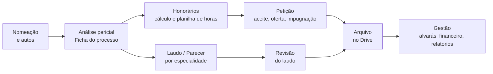

# Igapó

**Ecossistema de skills de IA para a rotina de perícia judicial.**

O igapó é a floresta inundada da Amazônia: água e árvores formam uma rede viva, em que cada parte alimenta a outra. O projeto segue a mesma lógica. Cada skill resolve uma etapa da perícia, e o resultado de uma vira a entrada da seguinte, da nomeação ao laudo arquivado.

> Vitrine do projeto. As skills, os modelos e as bases de dados são privados e evoluem continuamente; este repositório descreve a arquitetura, as decisões de projeto e o funcionamento, sem expor conteúdo operacional.

---

## O problema

Um instituto de perícia judicial lida, todos os dias, com tarefas que se repetem e exigem precisão:

- analisar a decisão de nomeação, os quesitos e os prazos;
- calcular honorários com tributos, rateio e referência de hora técnica;
- redigir petições de aceite, honorários, impugnação, prazo e alvará;
- montar laudos e pareceres de várias especialidades, com fotografias, quesitos e fundamentação;
- controlar alvarás, pagamentos e a carteira de processos ativos.

Feito à mão, cada passo consome horas, depende da memória de quem executa e varia de pessoa para pessoa.

## A solução

Um conjunto de skills de IA que rodam no Claude (Cowork e Claude Code). Cada skill encapsula um procedimento do instituto, com o padrão documental de cada empresa do grupo, e entrega o documento pronto para conferência humana.

## Princípios de projeto

| Princípio | Como aparece |
|---|---|
| **Humano no controle** | Toda pendência sai destacada para conferência; nada é enviado, protocolado ou assinado automaticamente. |
| **Fonte rastreável** | Cada informação extraída dos autos indica a movimentação de origem. |
| **Fato não se inventa** | Dado ausente é marcado como ausente, nunca estimado. |
| **Padrão por empresa** | Papelaria, fonte, assinatura e vocabulário mudam conforme a empresa do grupo, sem ajuste manual. |
| **Autossuficiência** | Skills que rodam em ambiente isolado carregam o que precisam, sem depender de pastas ou planilhas externas. |
| **Revisão integrada** | As skills de laudo revisam a peça inteira antes da entrega e geram relatório de pendências. |

Detalhes em [docs/decisoes.md](docs/decisoes.md).

## O ecossistema

São cerca de vinte skills, organizadas em cinco áreas. O catálogo completo está em [docs/catalogo.md](docs/catalogo.md).

| Área | Exemplos |
|---|---|
| Entrada do processo | análise da nomeação, histórico pericial, varredura de tarefas |
| Honorários | perito nomeado, assistência técnica, planilha de horas, atualização monetária |
| Peças processuais | petições periciais, propostas, contratos de parceria |
| Laudos e pareceres | engenharia civil, engenharia elétrica, medicina, demais especialidades, revisão |
| Gestão | diligências de alvará, planilha financeira, relatórios gerenciais, arquivo no Drive |

## Tecnologia

- **Claude Skills** (Anthropic), executadas no Claude Cowork e no Claude Code
- **Python** para geração de DOCX, PDF e XLSX, cálculos e conferências
- **Integrações**: Google Drive, sistemas de gestão jurídica e consulta a tribunais
- **Índices oficiais** (SELIC, IPCA, INPC, IGP-M) colhidos na fonte no momento do cálculo

Arquitetura em [docs/arquitetura.md](docs/arquitetura.md).

## Status

Em uso na rotina do instituto e em evolução contínua. Esta vitrine é atualizada quando surge uma nova área, não a cada versão das skills.

---

© Todos os direitos reservados. O conteúdo deste repositório é apenas descritivo; nenhuma skill, modelo ou dado operacional é distribuído.
