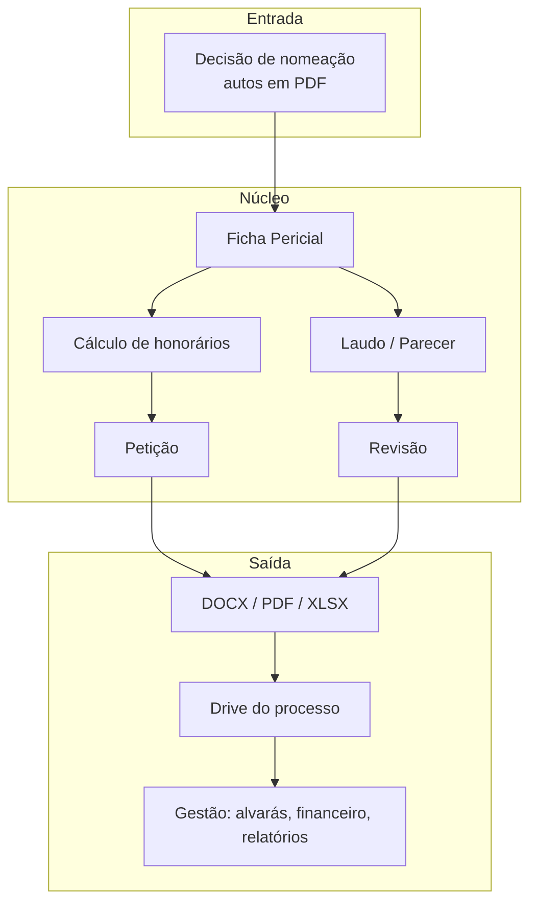

# Arquitetura

## Visão geral

O Igapó não é um sistema único: é um conjunto de skills independentes que compartilham convenções. Cada skill pode ser usada sozinha, mas foi desenhada para receber o que a anterior produz.



## Anatomia de uma skill

```
skill/
├── SKILL.md        instruções, gatilhos de uso e limites (o que a skill NÃO faz)
├── references/     regras de negócio, vocabulário, checklists
├── scripts/        geração de documentos, cálculos, conferências
├── assets/         papelaria, fontes e modelos por empresa
└── exemplos/       casos sintéticos para teste
```

- **Gatilhos e limites explícitos**: cada skill declara quando deve ser usada e quando deve passar a vez para outra, o que evita sobreposição entre elas.
- **Execução em tarefas**: o trabalho é dividido em etapas verificáveis; o modelo conclui e confere uma antes de iniciar a próxima.
- **Scripts determinísticos**: o que exige exatidão (cálculo, formatação, montagem de documento) fica em código, não no texto gerado pelo modelo.

## Saídas

- Documentos em **DOCX e PDF** na papelaria da empresa, com pendências destacadas para conferência.
- **Planilhas XLSX** de horas e de controle financeiro.
- **Relatório de pendências** separado da peça, quando há algo a conferir.

## Ambiente

- Execução principal no **Claude Cowork** (ambiente Linux isolado) e no **Claude Code**.
- Integrações por conectores (Google Drive, e-mail, agenda) e por navegador, sempre com autorização do usuário para qualquer ação externa.
